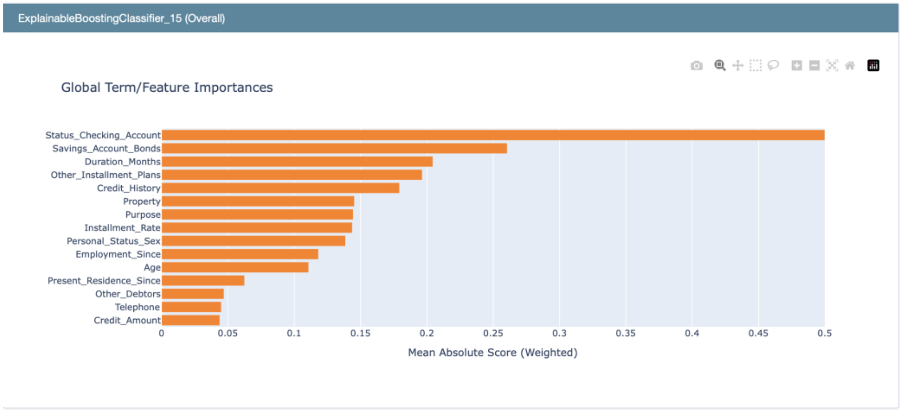
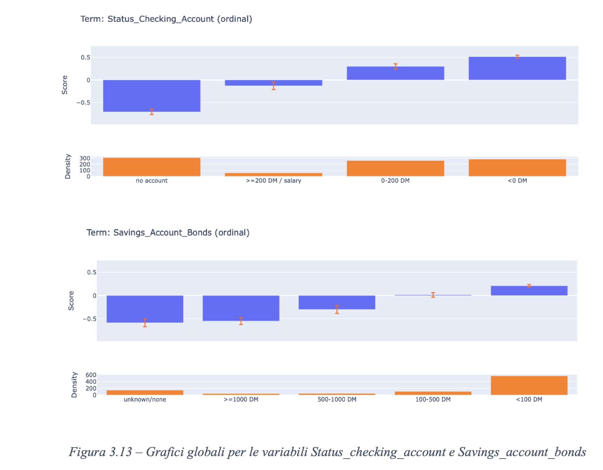
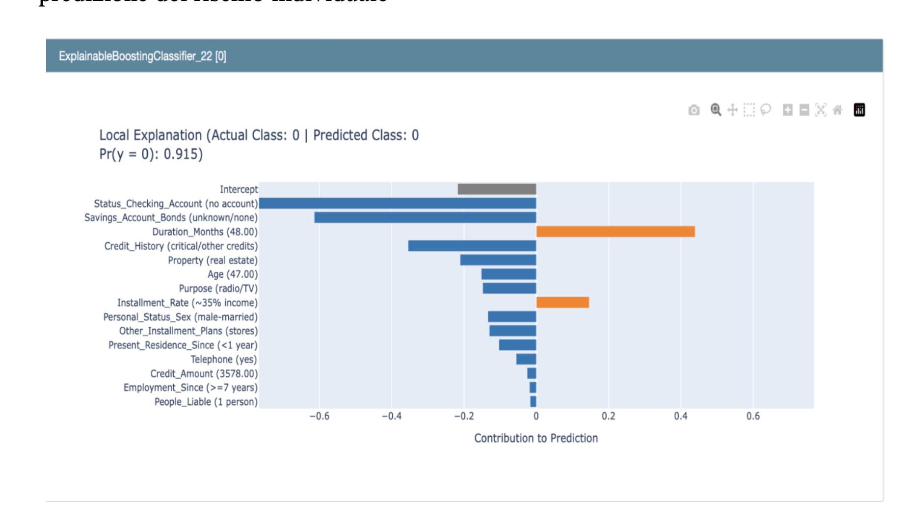
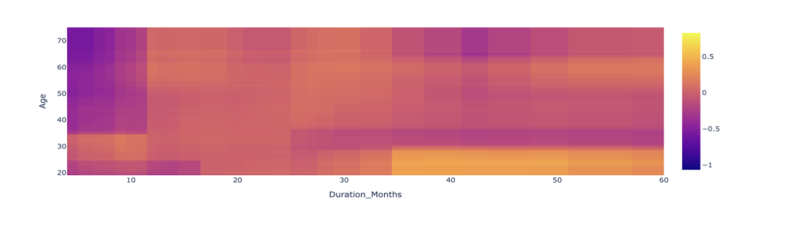

# Interpretable Credit Scoring with Explainable Boosting Machines

Evaluation of Explainable Boosting Machines (EBM), a glass-box GA²M model developed by Microsoft Research, for credit scoring, benchmarked against traditional Weight of Evidence (WoE) logistic regression on two credit risk datasets.

## Overview

The growing adoption of Machine Learning in credit risk assessment has highlighted a key challenge: balancing predictive performance with model interpretability, transparency, and auditability.

This project investigates whether Explainable Boosting Machines (EBM), an interpretable machine learning model based on Generalized Additive Models with pairwise interactions (GA²M), can represent a viable alternative to traditional credit scoring approaches.

The empirical analysis compares EBM with Weight of Evidence (WoE) Logistic Regression, a benchmark methodology developed in line with established banking practices, to assess their predictive performance, interpretability, and ability to capture economically meaningful relationships.

The evaluation is conducted on two credit risk datasets representing different scoring contexts:

- **German Credit Dataset:** application scoring, comprising 1,000 credit applicants, used to investigate predictive performance, model generalization, and the economic and financial plausibility of learned relationships.
- **Give Me Some Credit:** behavioural scoring, comprising over 150,000 observations, used to examine model performance under substantial class imbalance and the presence of missing values.

The overall objective is to assess whether EBM can achieve a competitive balance between predictive accuracy, transparency, and robustness in estimating credit default risk, while addressing the governance and auditability requirements relevant to financial institutions.

## Methodology

The empirical analysis follows a consistent experimental framework, applying the same data splitting strategy and class weighting approach to both models.

### Experimental Setup

- **Train-Test Split:** 70% training set and 30% test set, using stratified sampling to preserve the original target class distribution.
- **Class Imbalance:** No resampling techniques were applied. Instead, a cost-sensitive approach was adopted by assigning twice the weight to default observations compared to non-default observations.
- **Evaluation:** Model performance was assessed on the hold-out test set using ROC-AUC, Precision, Recall, Specificity, and Confusion Matrix. Classification metrics were evaluated using the Youden's J statistic to determine the classification threshold.

### Model Implementation

The two models required different preprocessing strategies, reflecting their underlying methodological differences:

- **Explainable Boosting Machine (EBM):** trained on the original input variables, leveraging its built-in capability to handle numerical and categorical features and automatically learn suitable feature discretization.
- **WoE Logistic Regression:** numerical variables were discretized through Optimal Binning and subsequently transformed into Weight of Evidence (WoE) values before fitting the logistic regression model.

## Tools & Libraries

The project was entirely developed in Python, using specialized libraries for statistical analysis, data preprocessing, and interpretable machine learning.

| Library | Purpose |
|---|---|
| **Pandas & NumPy** | Data manipulation and numerical computing |
| **ydata-profiling** | Exploratory Data Analysis (EDA) and data quality assessment |
| **InterpretML** | Implementation and interpretation of Explainable Boosting Machines |
| **OptBinning** | Optimal Binning and Weight of Evidence (WoE) transformations |
| **Statsmodels** | Logistic Regression estimation using Generalized Linear Models (GLM) |
| **Scikit-learn** | Model evaluation and classification metrics |
| **Matplotlib** | Data visualization and graphical analysis |

### Main Technologies

Python · Jupyter Notebook · InterpretML · OptBinning · Statsmodels · Scikit-learn

## Key Results & Discussion

### 1. Empirical Performance Comparison (Youden's J Threshold)

| Dataset | Model | ROC-AUC | Accuracy | Recall (1) | Specificity (0) | Precision (1) |
| :--- | :--- | :---: | :---: | :---: | :---: | :---: |
| **German Credit** | WoE Logistic Regression | 0.779 | 0.740 | 0.733 | 0.743 | 0.550 |
| **German Credit** | **EBM** | **0.806** | 0.733 | **0.800** | 0.705 | 0.537 |
| **Give Me Some Credit** | WoE Logistic Regression | 0.858 | 0.770 | **0.791** | 0.769 | 0.197 |
| **Give Me Some Credit** | **EBM** | **0.864** | **0.794** | 0.775 | **0.796** | **0.214** |

* **Confusion Matrices (Youden cutoff):**
  * **German Credit — Logistic Regression:** `[[156, 54], [24, 66]]`
  * **German Credit — EBM:** `[[148, 62], [18, 72]]`
  * **Give Me Some Credit — EBM:** `[[33407, 8585], [676, 2332]]`
  * **Give Me Some Credit — Logistic Regression:** `[[32290, 9702], [630, 2378]]`

### 2. Model Explainability & EBM Dashboard Highlights

EBM produces glass-box explanations that can be inspected interactively in a single dashboard, turning model predictions into transparent visual scorecards aligned with risk governance and AI Act transparency requirements.

* **Global Feature Importance:** Financial and balance-sheet variables—led by `Status_Checking_Account`, `Savings_Account_Bonds`, and `Duration_Months`, followed by `Credit_History`, `Purpose`, and `Installment_Rate`—drive most of the predictive power ahead of purely socio-demographic attributes.
  

* **Global Shape Functions (`Status_Checking_Account` & `Savings_Account_Bonds`):** Overdraft balances (`<0 DM`) push risk upward, whereas stronger balances lower it; notably, `no account` shows a negative risk contribution, consistent with smaller loan sizes or stricter screening for applicants without an active checking account.
  

* **Local Explanation (Individual Scorecard):** For each applicant, EBM breaks down the prediction into positive and negative feature contributions around the baseline/intercept, showing both the exact score drivers and the resulting probability estimate.
  

* **Pairwise Interaction (`Age` vs. `Duration_Months`):** While pairwise interactions add visual complexity and slightly lower AUC compared to the purely additive EBM in these datasets, the interaction surface illustrates how risk shifts across combinations of age and loan duration (such as higher risk for younger applicants with longer durations versus lower risk for older applicants with shorter durations).
  

### 3. Native Handling of Missing Values (*Give Me Some Credit*)

Unlike standard models that require manual imputation, EBM treats missing values (`NaN`) as an explicit category during automatic binning, learning a dedicated risk contribution directly from the data. This avoids imputation bias and captures informative missingness typical of behavioural credit data (such as incomplete credit history or tracking anomalies).

| Feature | % Missing (Train) | % Missing (Test) | Log-Odds (Missing) | ΔProb (Missing) | Default Rate (Missing %) | Sample Avg Default (%) | Lift vs. Avg (%) |
| :--- | :---: | :---: | :---: | :---: | :---: | :---: | :---: |
| `MonthlyIncome` | 19.74% | 20.02% | -0.0937 | -0.0234 | 5.48% | 6.68% | -1.20% |
| `NumberOfDependents` | 2.59% | 2.67% | -0.1006 | -0.0251 | 4.15% | 6.68% | -2.53% |
| `NumberOfTime30-59DaysPastDueNotWorse` | 0.17% | 0.19% | +0.5319 | +0.1299 | **54.40%** | 6.68% | **+47.72%** |
| `NumberOfTimes90DaysLate` | 0.17% | 0.19% | +0.6388 | +0.1545 | **54.40%** | 6.68% | **+47.72%** |
| `NumberOfTime60-89DaysPastDueNotWorse` | 0.17% | 0.19% | +0.4213 | +0.1038 | **54.40%** | 6.68% | **+47.72%** |
| `age` | 0.04% | 0.04% | +0.8431 | +0.1991 | 4.44% | 6.68% | -2.24% |

* **Informative Missingness as a Risk Signal:** Applicants with missing delinquency records (`30-59`, `60-89`, and `90+` days past due) exhibit a **54.40% default rate**—nearly eight times the sample average of **6.68%**. EBM automatically assigns positive log-odds (`+0.42` to `+0.64`) to these missing bins, turning data reporting gaps into an effective risk discriminator for incoming applicants.

### 4. Main Findings & Regulatory Implications

- **Competitive Predictive Power with Minimal Preprocessing & Guided Tuning:** EBM matched or outperformed traditional WoE Logistic Regression across both datasets—despite the structured, low-dimensional nature of credit scoring data typically favoring parsimonious linear models. Built-in binning and native missing-value handling kept preprocessing lean while reducing arbitrary manual choices, and the interactive dashboard actively guided model tuning by letting you inspect shape functions and evaluate estimate stability across bags to guard against overfitting while maintaining strong generalization.
- **Additive Structure Outperforms Pairwise Interactions:** Contrary to standard expectations for GA²M models, adding pairwise interaction terms slightly reduced ROC-AUC on both datasets compared to the purely additive EBM. This indicates that credit default drivers in these portfolios are predominantly additive, aligning with established industry reliance on parsimonious scorecards.
- **Visual Scorecards & EU AI Act Compliance:** EBM's learned shape functions act as transparent visual scorecards, clearly isolating each variable's positive or negative contribution to default risk. Crucially, unlike post-hoc explainability methods applied to black-box models, these plots represent the *exact* internal contributions learned by the glass-box model rather than an approximation of them—supporting auditability, human oversight, and compliance with the **European AI Act** for high-risk credit scoring systems.
- **Probability Calibration under Cost-Sensitive Training:** Because a 2:1 cost-sensitive class weight was applied during training to handle class imbalance, raw predicted probabilities are shifted upward. Post-hoc probability calibration (evaluated in the third notebook) restores well-calibrated Probability of Default (PD) estimates suitable for risk management.

